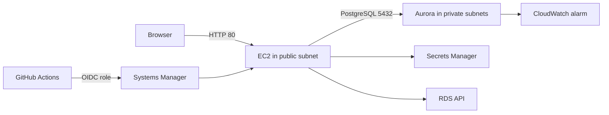

# DB Fleet Inspector

A learning project that checks Aurora PostgreSQL settings on AWS and shows the results on a small web page.

## Architecture

## What it demonstrates

- VPC with public and private subnets
- Aurora PostgreSQL Serverless v2 with a writer and a reader
- Managed master password in Secrets Manager
- Least-privilege IAM roles
- Server access through Session Manager, without SSH
- Tested failover and point-in-time restore
- CloudWatch CPU alarm
- GitHub Actions deploy with OIDC, without stored AWS keys
- All core infrastructure in Terraform

## Known limits

- Deletion protection is off so the lab can be destroyed
- The web page uses HTTP
- The alarm does not send notifications yet
- In production, I would start with AWS Config

## Clean up

Run terraform destroy after use.
## Build manual

Every step is in [MANUAL.md](MANUAL.md).
